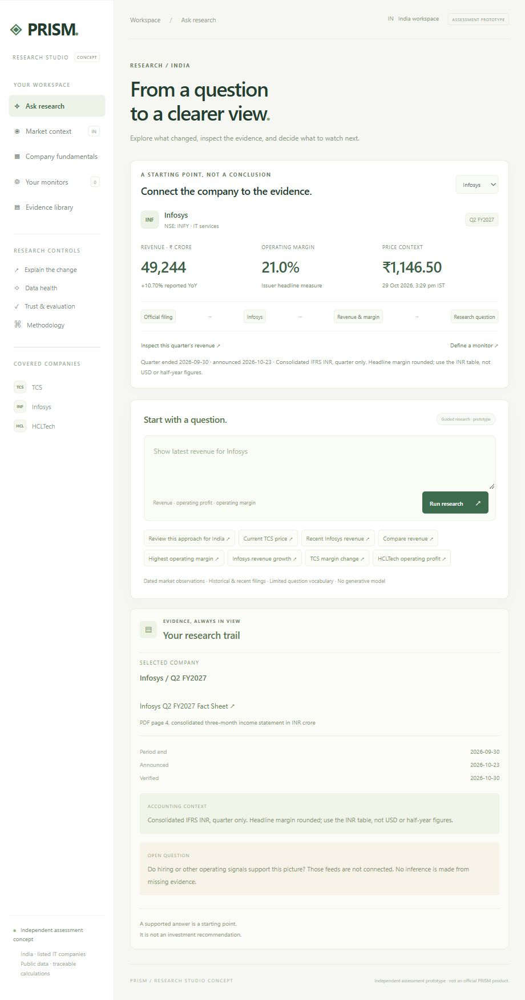

# PRISM Research Studio - assessment concept

An India-only, evidence-first market and research prototype covering **official NIFTY 200 and NIFTY 500 universes**, with verified filing-based financial analysis for **TCS, Infosys and HCLTech**. It helps an analyst answer a financial question without losing the reporting period, metric definition or source behind a number.

**Historical scope:** consolidated FY2023 and FY2024 revenue and company-reported operating profit/EBIT; derived operating margins, year-on-year growth and margin changes. Indian financial years end on 31 March. Values use INR crore and Indian digit grouping. India-focused means India-listed companies; their consolidated revenues include international operations.

## Quick start and dependencies

- Python **3.10 or newer** and a modern browser.
- **No third-party Python packages. The core workflow needs no API key.** `requirements.txt` intentionally has no package requirements.
- Internet access is required to refresh public market data or open source links. The bundled snapshot and test suite work offline.
- Git is optional for downloading/cloning; it is not required to run the downloaded project.

From the project folder:

```sh
python app.py --port 18765
```

Open **http://127.0.0.1:18765**. Keep the terminal running and open this address manually; the app does not launch a browser. Do not use VS Code Live Server. If Windows blocks a port, choose another using `--port`.

Run the checks with:

```sh
python evaluate.py
```

On Windows, use `py` instead of `python` if needed. No database, Node.js, paid data subscription or model service is required. This is a local research prototype, not a production deployment.



## Optional OpenAI research brief

After a supported research answer, click **Generate brief** for a summary, cited
observations, limitations and follow-up research questions. The original financial
table and calculations remain visible. The brief is AI commentary requiring review;
checking source IDs does not prove the claims are supported by those sources.

Setup:
1. Copy the blank .env.example file to .env in this project folder.
2. Add your OpenAI API key to OPENAI_API_KEY in .env using a local editor.
3. Start or restart the app. Ask a supported question, then click Generate brief.

OPENAI_MODEL defaults to gpt-4.1-mini and can be changed in .env. Process environment
variables override file values. No dotenv package is required. The browser never
receives the key. The status badge confirms configuration only, not model access,
billing or successful live execution.

**Key protection:** .env and .env.* are ignored by Git; only the intentionally blank
.env.example is allowed. Never paste a key into source code, chat, browser fields,
screenshots or a public repository. The local HTTP server does not expose .env.
Gitignore does not remove a key that was previously committed.

The button sends the question and its server-retrieved evidence to OpenAI's Responses
API. It does not send the entire market dataset. Requests use store=false, no tools,
a 25-second timeout and a 1,200-output-token cap. Store=false is not a claim of zero
provider retention. API usage may be billed to your account. No automatic model calls
occur during normal research, refresh, startup or tests.

One request runs at a time. Successful briefs are cached in memory for 15 minutes,
with at most 32 entries; changed evidence invalidates the cache. There are no automatic
retries. Missing keys, insufficient evidence, invalid references, incomplete responses,
refusals and API errors preserve the deterministic answer.

**Validation status:** 10 offline adapter tests are included in the 47-test suite.
They use mocked responses and test the integration contract, not live model quality.
No live OpenAI request has been verified for this submission because no key was
configured. Before presenting generated results, run a real request and review its
figures, periods, citations and unsupported inferences.

Architecture: browser click → server recomputes evidence → bounded OpenAI request →
response and source-ID validation → separately labelled commentary. Unsupported
financial queries are not forwarded to the model. It cannot execute tools, refresh
filings, modify the verified table or fill missing coverage.

Reference: https://developers.openai.com/api/docs/guides/structured-outputs
Model: https://developers.openai.com/api/docs/models/gpt-4.1-mini

## Trading universes and research audit

Choose **NIFTY 200 (200 securities)** or **NIFTY 500 (500 securities)**. These are official index constituents, not a custom market-cap ranking. Official CSV snapshots were retrieved on 30 October 2026 and are preserved in `data/constituents/`, with source hashes in the normalized JSON files.

The NIFTY 500 source contained 501 rows including an explicitly labelled DUMMYHEG placeholder. The normalization excludes that placeholder and records it in the audit. Real non-EQ constituents are retained in membership, but excluded from the EQ research screen. Current membership is not a point-in-time historical universe.

The saved refresh loaded **499 of 500 securities plus three benchmarks**. BAGMANE returned a provider error; missing data is shown rather than fabricated. Verified financial-statement analysis still covers only **TCS, Infosys and HCLTech**.

### Decision-support features

- Select minimum completed observations, share price and average traded value. Default history is 200 observations. The turnover proxy uses unadjusted close times volume over the last 20 completed observations, in INR crore; missing volume is not backfilled.
- Inspect every exclusion: non-EQ series, missing/stale data, failed refresh, short history or insufficient liquidity. Passing means data eligibility, not investment quality or broker eligibility.
- Compare sector composition before and after screening. Shares are counts of securities, not portfolio or index weights. Exclusion reason counts overlap.
- Search, filter, sort, paginate and export the filtered list to CSV.
- **Download research pack** creates one Markdown file containing a readable brief, applied settings, display filters, source timestamps, full selected-universe evidence and a SHA-256 fingerprint. The fingerprint detects report changes; it does not prove source accuracy. No model or API key is needed.

### Reproduction

`GET /api/trading-universe?index=nifty500&min_history=200&min_price=0&min_turnover_crore=0`
returns the full report, diagnostics and fingerprint. `GET /api/universe?index=nifty200` returns membership only. `/api/current` supplies compact market summaries and `/api/history/<NSE-symbol>` supplies one cached history.

Run `python universe.py --index all` to explicitly refresh both lists, then restart the app to reload the provider map. Run `python market.py` to refresh prices. The UI refresh is a background job with six workers, visible progress, retained original timestamps on failures and a one-minute throttle. Refreshes are manual, not scheduled.

Run `python evaluate.py`: **47 automated test methods** plus 16 historical question cases. Tests cover missing and stale data, threshold boundaries, source normalization, membership isolation, sector-share arithmetic, overlapping exclusions, fingerprint sensitivity and mocked AI failures. They do not demonstrate investment performance or unrestricted LLM accuracy.

### Three-minute interview demo

1. State the problem: an analyst needs a shortlist whose data gaps and selection assumptions are visible.
2. Switch between NIFTY 200 and 500; explain membership versus verified financial coverage.
3. Apply a traded-value threshold, inspect exclusions, and compare sector composition.
4. Open a supported company question, inspect its filing and calculation, then download a research pack.
5. Explain production priorities: licensed point-in-time data, exchange-calendar freshness, broader filing verification, user testing and independently reviewed AI evaluation.

This expanded prototype exceeds the original two-to-three-hour trial scope. Be candid about time spent and AI assistance. Present the small core workflow first, and describe later additions as extensions.

## Product structure

This is an **independent PRISM-inspired assessment concept**, not an official PRISM product, a copy of its private application, or an integration with Spectra. The public product description at [prismxlabs.com](https://prismxlabs.com/) informed the workflow. No affiliation, approval or proprietary alternative-data access is claimed. An optional OpenAI commentary feature is available when configured; the core evidence engine is deterministic.

The primary journey is **question → company context → evidence → explicit monitor**:

- **Ask research:** selected-company context combines a dated market observation with a separately dated quarterly disclosure. Ask a supported question, then inspect the response and its linked evidence. An open-question card identifies missing alternative data instead of inventing it.
- **Evidence trail:** a persistent desktop side panel (stacked on narrow screens) displays sources, reporting/announcement/verification dates, accounting caveats and unsupported-answer boundaries. Review references are distinguished from claim-level source linkage. Technical timing and model-call details are tucked into a Research audit disclosure.
- **Your monitors:** create an explicit above/below threshold for a company's quarterly revenue growth, headline operating margin or 20-session price change. Rules are stored only in this browser's localStorage. They are evaluated on opening/checking the monitor view against saved observations, with source links and timestamps. Stale/missing data gives a Needs data result. A met condition is not a trading signal.
- **Market context / Company fundamentals:** supporting workspaces keep current observations and historical annual analysis distinct.
- **Evidence library:** recent quarterly and historical annual disclosures are grouped separately.
- **Research controls:** arithmetic explanations, historical data health, evaluation and methodology remain available without dominating the main user journey.

No scheduled monitoring, alerts, delivery, user accounts or alternative-data integrations are active. The monitor builder uses explicit controls; it does not claim to interpret arbitrary natural-language monitoring instructions. Browser storage can be cleared or unavailable and does not sync across devices. Rule checks are strict above/below; equality does not meet the condition. Thresholds are chosen by the user, not optimized or validated investment rules. The prototype supports up to 20 local rules.

`static/studio.js` owns company context, evidence-trail rendering and the local-rule workflow; `static/app.js` retains financial views, chart controls and server requests. `app.py` serves both. Financial tests remain unchanged, and the new workflow was manually checked in the browser: quarterly lookup → linked evidence → rule creation → condition evaluation → persistence across reload → rule removal, plus disclosure grouping in the library.

## Dashboard

The Ask research workspace opens by default. Market context and Company fundamentals preserve the current-price and historical-fundamentals views. The historical dashboard It includes four summary cards, a financial-year selector, paired revenue and operating-margin comparison bars, revenue-growth comparisons, an issuer coverage panel, and a searchable, sortable company watchlist. Explore opens a company query in the research assistant. CSV export includes both figures and the company-specific operating-profit basis. Source library and methodology remain available from navigation.

All historical-dashboard figures derive from the same fixed facts used by the assistant. Covered revenue is the sum of these three companies, not an Indian market index. FY2023 growth is shown as unavailable because FY2022 is outside the dataset. Financial comparison bars begin at zero and do not represent share prices.

## Current Indian markets

The Market context view covers **200 NIFTY constituents plus NIFTY 50, NIFTY IT and India VIX**. It shows provider prices and timestamps, comparisons to the prior daily close, complete-session charts, 20-session changes, 50/200-session moving averages and annualised 20-return realised volatility. Index levels, volatility-index points and INR-per-share quotes are distinguished.

- Provider: Yahoo Finance's public chart endpoint (`query1.finance.yahoo.com/v8/finance/chart/…`), an unofficial service with no availability or latency guarantee. Data can be delayed or throttled; this is not a licensed real-time exchange feed. Provider source links are displayed per instrument. Review provider terms and exchange licensing before redistribution or production deployment.
- Select **Refresh market data** to request six fixed instruments in parallel. Refresh is throttled to one batch per minute. Opening the current view requests a refresh when the last attempt is more than five minutes old. No scheduled background job is installed.
- `python market.py` refreshes the saved snapshot from the command line. Errors are shown per instrument. Failed requests retain the original observation/retrieval timestamps; they never turn old data into a fresh quote.
- `data/current_market.json` stores the last observations and one year of daily history. Every quote is dated. The 96-hour freshness heuristic uses elapsed time; it is not a trading-holiday calendar or proof that a quote is from the latest session.
- Daily indicators exclude today's bar until 15:35 IST. Rows with missing/non-positive/non-finite prices are omitted without forward filling. If adjusted closes are available they are used, otherwise unadjusted history is explicitly labelled. Missing adjusted values can make indicators end earlier than the displayed quote; both dates are shown. Provider adjustments are not independently audited.
- Moving averages are simple means over the last 50/200 valid daily observations. Momentum is `(P[t]/P[t-20] - 1)*100`. Volatility is sample standard deviation of 20 daily simple returns × sqrt(252) × 100. These are descriptive, not validated signals. Insufficient history produces missing metrics, not zeros.
- Quarterlies are **manually verified Q2 FY2027**, ended 30 September 2026, with announcement dates, rounded issuer margins and source links in `data/recent_results.json`. Verified 30 October 2026; price refresh does not ingest new financial reports. After 120 days, the view flags the filing verification for review. Definitions differ and quarterly values are not annualised or mixed with annual totals.

Bot examples: `Review current Indian markets`, `Show current price for TCS`, `Show latest revenue for Infosys`, `Show current operating margin for HCLTech`. Current-data routing in `app.py` is separate from the historical engine, whose explicit unsupported-period tests remain unchanged. Unsupported current queries do not invoke unrestricted generation. Bot reviews use the saved snapshot; refresh it in Current markets before requesting a review.

Read APIs: `GET /api/current` reads the saved snapshot and recomputes freshness. `POST /api/current/refresh` refreshes it, subject to the one-minute throttle and same-origin checks.

The 35 offline test methods include fixed indicator oracles, proper prior-session change calculation, incomplete-session exclusion, missing/short history, bad currency, future/stale timestamps, failed-refresh timestamp preservation and a recent-quarter filing oracle. The separate 16 question-level cases assess the historical engine; their pass rate is not an accuracy score for live prices or the full current-market bot. The fingerprint includes market logic, recent filings and market tests, but excludes the changing provider cache. Successful provider retrieval was checked separately during development.

## Quant research tools

Three additional views are available from the sidebar and compact navigation:

- **Data quality:** 22 checks covering required observations, unit metadata, numeric plausibility, fiscal-year alignment, source locators, missing publication dates, issuer comparability and observation age. The current dataset yields 13 passes, 9 warnings and no failures as of 30 October 2026. These are not independent financial audits or a composite quality rating. The freshness threshold is an explicit 730 days from period end, appropriate to flagging this historical demo.
- **What changed?:** a selectable-company FY2023-to-FY2024 operating-profit bridge. Revenue-scale effect = change in revenue × starting margin. Margin effect = ending revenue × change in margin. The two effects sum exactly to the profit change. This ordering puts the interaction term in the margin effect. It does not identify causal drivers such as pricing, FX or acquisitions. Negative contributions are shown in a different colour.
- **Evaluation:** 16 handcrafted question cases (six explicit numeric expectations and ten expected refusals), citation-ID linkage, 35 test methods, local timing and zero model-call cost. Citation linkage is not semantic source verification. A content fingerprint detects changes to engine, analytics, data, fixtures and tests since the saved evaluation. Results are regression checks, not a claim of accuracy on unrestricted questions.

Run `python evaluate.py` to regenerate the saved report; the browser's reload button only rereads it. Observation age uses the current India date at request time. Source verification date and source publication date remain distinct.

Additional read-only endpoints: `/api/quality`, `/api/changes/TCS` (also `INFY` and `HCLTECH`), and `/api/evaluation`. Analysis lives in `analytics.py`; explicit evaluation cases are in `data/eval_cases.json`.

## Run

Requires Python 3.10 or newer. No third-party package installation. Core research needs no API key; optional OpenAI briefs require one. Current-price refresh requires outbound internet access to query1.finance.yahoo.com; cached historical analysis and automated tests work offline.

```sh
python app.py --port 18765
```

Open **http://127.0.0.1:18765**. On Windows, `py app.py` also works if Python is registered with the launcher. `python app.py --port 8766` selects another port. Stop with Ctrl+C. This local server is a development demo, not production hosting.

Run the evaluation and reproduce the example outputs:

```sh
python evaluate.py
```

The command checks financial values, derived outputs, fiscal-year parsing, source linkage, reproducibility, and refusal cases, then writes `evaluation.json`. Engine timings exclude the browser and network. The suite is handcrafted and does not establish accuracy on arbitrary questions.

## Try these five questions

1. Compare revenue for TCS, Infosys and HCLTech in FY2024
2. Which company had the highest operating margin in FY2024?
3. How did Infosys revenue grow from FY2023 to FY2024?
4. How did TCS operating margin change from FY2023 to FY2024?
5. Show HCLTech operating profit in FY2024

Also try `TCS EBITDA in FY2024`, `Compare TCS and Wipro revenue FY2024`, and `TCS latest revenue`. Each should decline with a reason rather than fabricate an answer or silently drop part of the question.

## Approach

`Question → explicit intent and scope checks → curated financial facts → Python calculations → answer + evidence + caveats`

The interface accepts a **limited natural-language vocabulary using deterministic rules**. It does not use an LLM, embeddings or general document retrieval. This is an auditable baseline for an LLM-backed product, not a claim to have built a general financial chatbot. Questions are independent; no conversational memory is retained.

The decision is to put evidence, financial-year interpretation and arithmetic before fluent prose. Within a small trial, this makes the failure boundary clear and makes every supported calculation reproducible. The same calculation layer could serve as validated tools for an LLM later.

Formulas:

- Operating margin = operating profit / revenue × 100.
- FY2024 growth = (FY2024 value / FY2023 value − 1) × 100.
- Margin change = FY2024 margin − FY2023 margin, in **percentage points**.

Calculations retain full precision until display. Margins calculated from INR-crore inputs can differ from rounded headline percentages or USD-denominated margins. Peer rankings apply only to the selected companies and use the disclosed metric definitions. They are not stock recommendations.

## Data and provenance

`data/companies.json` contains **12 manually curated numeric facts**: two metrics × two annual periods × three companies, plus source locators and metric definitions. The numbers were checked against official public disclosures on **30 October 2026**, using web-accessible text. This is a fixed historical demonstration; it does not claim to use the latest available filings. Full source PDFs are not bundled; the historical demo and saved market snapshot work offline, while external source links need internet access.

| Company | Official source | Locator | Operating-profit basis |
|---|---|---|---|
| TCS | [Integrated Annual Report 2023-24](https://www.tcs.com/content/dam/tcs/investor-relations/financial-statements/2023-24/ar/annual-report-2023-2024.pdf) | Financial Capital, printed p.17 | Management operating profit; FY2024 excludes settlement of legal claim |
| Infosys | [Q4 FY2024 Fact Sheet](https://www.infosys.com/investors/reports-filings/quarterly-results/2023-2024/q4/documents/fact-sheet.pdf#page=4) | PDF p.4, annual INR table | Consolidated IFRS operating profit; not the quarterly or USD table |
| HCLTech | [Annual Report 2023-24](https://www.hcltech.com/sites/default/files/document/open/annual-report/2024-07/HCL_AR_2023-24_compressed.pdf) | Corporate Overview, printed p.13; consolidated results p.102 | Earnings before other income, tax and finance cost |

The compact source rows are numeric transcriptions, not complete document quotations. The source library shows those rows and links back to the originals. **Publication dates have not been recorded.** Verification dates are not publication dates. The assistant explicitly declines “as of” questions; this dataset cannot establish when information first became available. External links can change and the evaluation does not verify their ongoing availability.

## Limitations and important assumptions

- Profitability measures are not fully normalized between issuers. TCS's exclusion is shown next to operating comparisons. No adjustment has been made to statutory accounts to force comparability.
- The vocabulary is intentionally narrow. Some valid paraphrases will be refused. Unknown company names and unsupported mixed requests are rejected. This is not a general semantic parser or a prompt-injection security benchmark.
- One metric per question. All selected companies are evaluated over the same requested years. Complex company-specific date mappings are not supported.
- No automatic PDF extraction, uploads, unrestricted narrative analysis, exchange-grade real-time feed, forecasts, standalone accounts, EBITDA, net profit or valuation. Recent quarterly disclosures are a separate, manually curated dataset.
- Inputs are manually curated and can contain transcription errors. The numeric test oracles are separately hardcoded but were prepared during the same development process, not by an independent auditor.
- The core evidence engine and offline evaluation make zero model calls. Optional OpenAI briefs incur API usage; the UI reports request counts and returned token usage without inventing a price. Total infrastructure and development costs are separate.
- The interface displays the query result and supports JSON export. It does not store queries or export a PDF.

## Before production

1. Ingest official NSE/BSE/company filings with immutable source hashes, page/table extraction, publication timestamps and version history; check extracted facts against accounting identities and reviewed samples.
2. Define a normalized accounting taxonomy with reported-versus-adjusted reconciliations. Keep global consolidated revenue distinct from geographic India revenue.
3. Add an LLM only to produce a typed query plan. Validate company, period, metric and permissions before calling deterministic retrieval/calculation tools. Return only claims backed by evidence IDs; abstain if evidence is missing. Evaluate against this baseline.
4. Expand the held-out evaluation with unseen paraphrases, unknown peers, conflicting figures, revised statements and adversarial inputs. Measure numeric accuracy, citation support, abstention precision/recall, end-to-end latency and real provider cost.
5. Add authentication, request limits, document access controls, observability and a proper deployment server.

## Code map and handoff

| File | Responsibility |
|---|---|
| `app.py` | Local HTTP server and request validation |
| `engine.py` | Scope checks, fiscal-year interpretation, retrieval, arithmetic and evidence |
| `data/companies.json` | Auditable fixed facts and source metadata |
| `static/` | Browser interface and JSON export |
| `tests/test_research.py` | Behavioral evaluation and explicit numeric oracles |
| `evaluate.py` | One-command evaluation and example-output generation |

`POST /api/ask` accepts `{"question":"Infosys revenue growth in FY2024"}`. The result includes `status`, `answer`, `rows`, `calculations`, `evidence`, `warnings`, engine latency and model-call counts. `GET /api/meta` exposes the fixed snapshot and demo questions. The server binds to loopback and is intended for local review.

AI assistance was used to develop this prototype. Before presenting it, review the parsing rules, source figures and tests; choose which trade-offs you agree with and explain them in your own words. No claim is made about personal hours spent or independent authorship.

## Bot review and suggestions

Select **Review this approach for India** in the assistant, or ask `Review this research approach for current Indian markets`. The bot returns a labelled suggestion box with a prototype review, a fundamental-growth/margin hypothesis to test, economic intuition and failure modes, current-data requirements, and out-of-sample execution-cost checks. This is a deterministic methodological review, not a current-market forecast or a validated trading strategy. Official NSE links support the methodology, not present market conditions. The original engine-only review is an offline methodological baseline. In the app, the current-market review now incorporates cached dated price observations and separately verified recent quarterly disclosures. It does not generate company trade recommendations.
